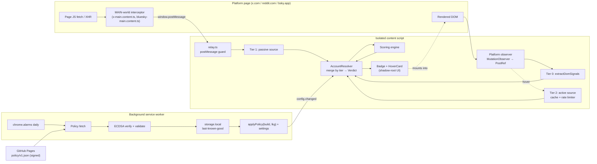

# Architecture

Botdar is a Manifest V3 browser extension that annotates post authors in-feed on X, Reddit and Bluesky
with a tier describing how many patterns common in automated accounts the account shows, plus a hover
card listing the reasons. Scoring detail lives in [scoring-spec.md](scoring-spec.md); this document covers
everything around it.

## Principles

1. **Local only.** Every signal is extracted and scored inside the user's browser. Nothing about any
   account leaves the browser. The only network request the extension makes on its own is a daily fetch
   of a signed policy file.
2. **Tiered sources, each switchable.** Every way of obtaining a signal has a tier. Tier 0 reads the
   rendered DOM. Tier 1 passively reads JSON responses the page already fetched for itself. Tier 2 makes
   extra, on-demand requests. Each tier is independently switchable per platform.
3. **Restrict-only remote policy.** A signed policy file can turn tiers or platforms off, lower caps,
   weaken feature contributions and raise thresholds without a store release. It can never enable
   anything the build has off or make a verdict stricter than the build would.
4. **Never hide posts.** The badge adds information. It never removes, dims or reorders content.
5. **Describe signals, not people.** The UI never calls an account a bot. It reports the patterns observed
   and says why the reading might be wrong.
6. **Defensive by default.** Page data is untrusted. Parsers return partials rather than throw. Schema
   drift degrades confidence instead of breaking the badge.

## System diagram



## Repository layout

```
botdar/
├─ wxt.config.ts                 # manifest, srcDir, preact preset, firefox gecko id
├─ package.json  pnpm-lock.yaml  tsconfig.json  vitest.config.ts  eslint.config.js
├─ .github/workflows/
│  ├─ ci.yml                     # lint, typecheck, test, build chrome+firefox, upload zips
│  ├─ pages.yml                  # verify policy signature, publish site/ + policy/dist/
│  └─ release.yml                # on tag v*: build, zip, attach to GitHub Release
├─ entrypoints/
│  ├─ background.ts              # policy loader, settings broker, install → onboarding
│  ├─ x.content.ts               # isolated world: X adapter + pipeline
│  ├─ x-main.content.ts          # world: MAIN, fetch/XHR interceptor
│  ├─ reddit.content.ts
│  ├─ bluesky.content.ts
│  ├─ bluesky-main.content.ts    # world: MAIN, XRPC interceptor
│  ├─ popup/  options/  onboarding/
├─ src/
│  ├─ core/
│  │  ├─ types.ts                # contracts below
│  │  ├─ scoring/                # engine, weights.default.json, reasons
│  │  ├─ handle/                 # shape.ts, bigram.ts, bigrams.json
│  │  ├─ policy/                 # schema, merge, verify, publicKey, loader
│  │  ├─ pipeline.ts             # AccountResolver
│  │  ├─ cache.ts  ratelimit.ts  settings.ts  messaging.ts  feedback.ts  relay.ts
│  ├─ platforms/
│  │  ├─ x/        adapter, observer, dom, interceptor.main, parsers/, sources/, features, queryIds
│  │  ├─ reddit/   adapter, observer, dom, parsers/, sources/, features, oldReddit
│  │  └─ bluesky/  adapter, observer, dom, interceptor.main, parsers/, sources/, features
│  └─ ui/
│     ├─ tokens.css  Badge.tsx  HoverCard.tsx  FeedbackButton.tsx  ConfidenceNote.tsx
│     ├─ hoverController.ts  mount.ts
│     └─ popup/  options/  onboarding/
├─ policy/
│  ├─ src/v1.json                # unsigned, human-edited
│  ├─ dist/v1.json               # signed envelope, served by Pages
│  └─ README.md
├─ scripts/                      # policy-keygen, policy-sign, policy-verify, build-bigrams, smoke/
├─ site/                         # GitHub Pages: index.html, privacy.html
├─ store/                        # listing copy, screenshots, promo tiles
├─ docs/                         # this folder
└─ tests/
   ├─ unit/**  dom/**
   └─ fixtures/{x,reddit,bluesky,policy}/
```

## Core type contracts

```ts
export type PlatformId = 'x' | 'reddit' | 'bluesky' | 'youtube';
export type SourceTier = 0 | 1 | 2;
export type IndependenceGroup =
  | 'age' | 'activity' | 'graph' | 'handle' | 'profile' | 'verification' | 'content' | 'geo';

export interface AccountRef {
  platform: PlatformId;
  handle: string;        // lowercased, no @ or u/ prefix
  id?: string;           // X rest_id, Bluesky DID, when known
}

export interface AccountSignals {
  ref: AccountRef;
  createdAt?: number;                 // epoch ms
  followers?: number;
  following?: number;
  postCount?: number;
  linkKarma?: number;
  commentKarma?: number;
  displayName?: string;
  bio?: string;
  hasDefaultAvatar?: boolean;         // true = default/none; undefined = unknown
  verified?: 'none' | 'blue' | 'org' | 'gov';
  declaredAutomated?: boolean;        // X "Automated" label, Reddit [App] tag, Bluesky `bot` self-label
  hasVerifiedEmail?: boolean;
  country?: string;                   // X "About this account"
  usernameChanges?: number;
  appStore?: string;
  replyShare?: { ratio: number; n: number };   // only when observable
  provenance: Partial<Record<keyof AccountSignals, SourceTier>>;  // which tier set each field
  observedAt: number;
}

export type FeatureId = string;       // key in weights.default.json, e.g. 'x.postsPerDay'

export interface Feature {
  id: FeatureId;
  value: number | boolean;
  group: IndependenceGroup;
  tier: SourceTier;
}

export interface Evidence {
  feature: FeatureId;
  contribution: number;               // signed log-odds after caps
  group: IndependenceGroup;
  tier: SourceTier;
  reason: string;                     // rendered, neutral wording
}

export type VerdictTier = 'typical' | 'some' | 'many' | 'declared' | 'unknown';

export interface Verdict {
  tier: VerdictTier;
  probability: number;
  logOdds: number;
  evidence: Evidence[];               // sorted by |contribution| desc
  reasons: string[];                  // 2–4 strings for the hover card
  confidence: number;                 // 0..1
  confidenceNote?: string;            // present when confidence < 0.7
  caveat: string;                     // "why this might be wrong"
  sourcesUsed: SourceTier[];
  sourcesMissing: SourceTier[];
  lowConfidence: boolean;             // drives the hollow badge
  policyVersion: number;
  computedAt: number;
}

export interface ResolveContext {
  signal: AbortSignal;
  policy: EffectivePlatformConfig;
  settings: Settings;
}

export interface SignalSource {
  id: string;
  platform: PlatformId;
  tier: SourceTier;
  kind: 'passive' | 'active';
  /** passive: start listening, push partial signals; returns unsubscribe */
  start?(emit: (ref: AccountRef, partial: Partial<AccountSignals>) => void): () => void;
  /** active: on demand; caching and rate limiting are the pipeline's job, not the source's */
  resolve?(ref: AccountRef, ctx: ResolveContext): Promise<Partial<AccountSignals> | null>;
}

export interface PostRef {
  element: Element;                   // article / shreddit-post / feed item
  ref: AccountRef;
  anchor: Element;                    // the badge is mounted after this element
  isReply?: boolean;
  nativeLabel?: 'automated';
}

export interface PlatformAdapter {
  id: PlatformId;
  matches(url: URL): boolean;
  observeFeed(
    ctx: ContentScriptContext,
    onPost: (post: PostRef) => void,
    onRemoved: (element: Element) => void,
  ): () => void;
  extractDomSignals(post: PostRef): Partial<AccountSignals>;   // Tier 0
  sources: SignalSource[];                                     // Tier 1 and Tier 2
  toFeatures(signals: AccountSignals): Feature[];
  badgeDensity: 'x' | 'reddit-post' | 'reddit-comment' | 'bluesky';
}
```

## Content-script architecture

### Relay envelope (MAIN world → isolated world)

Both X and Bluesky need a MAIN-world script because the isolated world cannot see the page's own
`fetch` responses. WXT registers it with `defineContentScript({ world: 'MAIN', runAt: 'document_start' })`,
which needs no `web_accessible_resources`.

The MAIN-world bundle is deliberately tiny and does no parsing. It patches `window.fetch` and
`XMLHttpRequest.prototype.open/send`, matches an allowlist of operations, always returns the original
response untouched, reads `response.clone().text()` asynchronously inside `try/catch`, and posts:

```ts
window.postMessage(
  { __botdar: 1, v: 1, kind: 'x.graphql', op, queryId, body: parsedJson },
  location.origin,
);
```

The isolated receiver in `src/core/relay.ts` accepts a message only when `event.source === window`,
`event.origin === location.origin`, `data.__botdar === 1` and `data.v === 1`. Bodies are untrusted: they
are walked with type guards, never evaluated, and dropped above 5 MB. `CustomEvent` is avoided because
Firefox requires `cloneInto` for cross-world `detail`.

### X (`x.com`, `twitter.com`)

| Concern | Approach |
|---|---|
| Interceptor allowlist | `HomeTimeline`, `HomeLatestTimeline`, `SearchTimeline`, `UserTweets`, `UserTweetsAndReplies`, `TweetDetail`, `UserByScreenName`, `AboutAccountQuery`, `Followers`, `Following` under `/i/api/graphql/<queryId>/<op>` |
| Tier 1 | `parsers/graphqlUsers.ts` walks any response for user objects: `core.screen_name`, `core.created_at`, `is_blue_verified`, `profile_bio.description`, `relationship_count`, `tweet_count`, `rest_id`, with `legacy.*` fallbacks. The X "Automated" label is expected in the user object (`legacy.automated` or `affiliates_highlighted_label`); confirm day one |
| Tier 0 | `article[data-testid="tweet"]:not([data-botdar])`; handle from `[data-testid="User-Name"] a[href^="/"]` whose text starts with `@`; default-avatar heuristic from `[data-testid="Tweet-User-Avatar"]` |
| Tier 2 | `AboutAccountQuery` on hover only: country, username-change count, app store. queryId resolution: observed from page traffic > policy value > baked constant. Limiter 20/min, burst 3, backoff on `x-rate-limit-reset` / `retry-after`, 60 s fallback |
| Observer | One `MutationObserver` on `document.body`, coalesced per pass via `requestIdleCallback` (150 ms timeout fallback); `data-botdar="1"` set only after a badge mounts; `WeakMap<Element, BadgeHandle>`; removed nodes unmount (X virtualizes its list) |
| Routing | `pushState` is invisible to the isolated world; compare `location.href` per pass plus `popstate`. Reset per-page state (reply-share counters), keep account caches |
| Reply share | Only on `/<handle>/with_replies`, counting articles with a "Replying to" row, minimum n = 20 |

### Reddit (`www.reddit.com`, `old.reddit.com`)

New Reddit renders `shreddit-*` custom elements with **open** shadow roots. The author is available
without piercing anything: `shreddit-post[author]`, `shreddit-comment[author]`, and `created-timestamp`
on posts.

| Concern | Approach |
|---|---|
| Badge anchor | Slotted light DOM: `[slot="credit-bar"] a[href^="/user/"]` for posts, `shreddit-comment [slot="commentMeta"] a[href^="/user/"]` for comments; fallback `el.shadowRoot?.querySelector(...)` |
| Shadow roots | The badge is a shadow-root UI with its own styles, so mounting inside a foreign shadow root is fine. A `MutationObserver` on `document` does not see mutations inside shadow roots, but new posts and comments arrive in light DOM (`shreddit-feed`, `shreddit-comment-tree`, `faceplate-partial`), which is enough for discovery |
| Tier 1 | Probably empty: new Reddit loads HTML partials, not JSON user objects. The switch exists; no interceptor ships unless day one shows otherwise |
| Tier 2 | Same-origin `/user/<name>/about.json?raw_json=1` with the user's cookies: `created_utc`, `link_karma`, `comment_karma`, `icon_img`, maybe `has_verified_email`. Cached 24 h; limiter 20/min |
| Native label | Reddit's `[App]` tag → `declaredAutomated`. Selector unknown; day-one item |
| old.reddit | `.thing[data-author]` + `a.author`; trivial adapter variant, may slip from v1 |

### Bluesky (`bsky.app`)

| Concern | Approach |
|---|---|
| Interceptor allowlist | XRPC calls the web app makes for feeds and threads: `app.bsky.feed.getTimeline`, `app.bsky.feed.getFeed`, `app.bsky.feed.getPostThread`, `app.bsky.actor.getProfile(s)`, `app.bsky.feed.getAuthorFeed`. Exact set confirmed day one |
| Tier 1 | Author objects in feed responses carry `did`, `handle`, `displayName`, `avatar`, `createdAt`, `labels` (a `bot` label with `src === did` is a self-label), `verification`, `associated`. No follower or post counts |
| Tier 0 | Feed items are React-rendered; handle from the profile link in the post header; Bluesky's own robot badge as a backup for the declared state |
| Tier 2 | `https://public.api.bsky.app/xrpc/app.bsky.actor.getProfiles?actors=…` (public, CORS `*`, no auth): `followersCount`, `followsCount`, `postsCount`, `description`, `avatar`. Batched up to 25 handles per call, cached 24 h, limiter 30/min. Because this is a sanctioned public read, Tier 2 on Bluesky carries no rate-limit or lock risk to the user's account |
| Native label | `bot` self-label → `declared`. Rendered alongside Bluesky's own robot badge, not instead of it |

### Badge and hover card mounting

`src/ui/mount.ts` wraps WXT `createShadowRootUi(ctx, { name: 'botdar-badge', position: 'inline', anchor,
append: 'after' })`. Mounting is idempotent: an existing `BOTDAR-BADGE` sibling is reused. The hover card
is one singleton `botdar-card` on `document.body`, positioned from `getBoundingClientRect` and flipped at
viewport edges; opens after 150 ms hover or on focus (`<button aria-describedby>`), closes 200 ms after
leaving both badge and card. Tier 2 fires on open; the card shows a loading state and re-renders. All
timers and observers register on `ctx` so an extension update invalidates cleanly.

## AccountResolver pipeline

`new AccountResolver(adapter, config, settings)` keeps `Map<handle, { signals, verdict, listeners }>`.

1. `attach(post)` runs Tier 0 immediately, merges any Tier 1 data already received for that handle,
   scores, and renders.
2. Tier 1 emissions arrive asynchronously and trigger a rescore for every mounted badge of that handle.
3. Tier 2 is scheduled on hover only, goes through the cache and rate limiter, then rescoring.
4. **Tier-merge rule:** a higher tier overwrites a lower tier's value for the same field; within the same
   tier, newer wins. `provenance` records the tier for each field so confidence can be computed.
5. `config.changed` from the background recomputes every verdict with the new effective config.
6. The map holds at most 2,000 accounts per tab (`MAX_TRACKED_ACCOUNTS`); past that, the least
   recently touched accounts with no post on screen are evicted a batch at a time.

## Policy system

### Unsigned source (`policy/src/v1.json`)

```jsonc
{
  "schema": 1,
  "version": 3,                        // monotonic; anti-rollback
  "issuedAt": "2026-10-22T00:00:00Z",
  "minExtensionVersion": "0.1.0",
  "platforms": {
    "x":       { "enabled": true, "tiers": { "t1": true, "t2": true },
                 "x": { "aboutAccountQueryId": "…" },
                 "thresholds": { "many": 0.65 },
                 "features": { "x.postsPerDay": { "cap": 1.5 } } },
    "reddit":  { "enabled": true, "tiers": { "t2": true } },
    "bluesky": { "enabled": true }
  },
  "rateLimit": { "x": { "perMinute": 20 } },
  "notice": { "id": "2026-10-a", "text": "X lookups paused while we fix a schema change", "url": "…" }
}
```

### Signed envelope (`policy/dist/v1.json`, served at `https://lcolobong.github.io/botdar/policy/v1.json`)

```json
{ "alg": "ES256", "kid": "2026-10", "payload": "<the unsigned JSON as a string>", "sig": "<base64url r||s>" }
```

The payload is signed as an opaque UTF-8 string so no JSON canonicalisation is needed.

### Scripts (Node 24, `node:crypto`, no dependencies)

| Script | Role |
|---|---|
| `scripts/policy-keygen.ts` | `generateKeyPairSync('ec', { namedCurve: 'prime256v1' })`. Prints the private key (PKCS8 PEM) to stdout only; writes the public JWK and `kid` into `src/core/policy/publicKey.ts` |
| `scripts/policy-sign.ts` | Validates `policy/src/v1.json` with the same `validatePolicy()` the extension uses, asserts `version` increased, signs with `crypto.sign('sha256', data, { key, dsaEncoding: 'ieee-p1363' })`, writes `policy/dist/v1.json`. Key from `POLICY_SIGNING_KEY` (PEM) or `--key-file` outside the repo |
| `scripts/policy-verify.ts` | Verifies `dist` with the baked JWK through the same `verify.ts` the extension uses. `pages.yml` runs this before deploying and never signs, so a tampered `dist` cannot be published |

Key custody: the private key lives in the maintainer's password manager. Rotation is a new `kid` shipped
in an extension release, with the old key accepted for one release.

### Verification flow (`src/core/policy/loader.ts`, in the service worker)

1. `browser.alarms.create('policy-refresh', { periodInMinutes: 1440, delayInMinutes: 1 })`, plus attempts
   on `runtime.onInstalled` and `onStartup`, with 0–30 min jitter.
2. `fetch(url, { cache: 'no-store' })` → parse envelope → `crypto.subtle.importKey('jwk', …, { name: 'ECDSA',
   namedCurve: 'P-256' }, false, ['verify'])` → `verify({ name: 'ECDSA', hash: 'SHA-256' }, key, sig, utf8(payload))`
   → `JSON.parse(payload)` → `validatePolicy()` → reject if `version < lkg.version` → store.
3. Any failure (network, signature, schema, rollback) leaves `policy.lkg` untouched and records
   `policy.lastAttempt = { at, ok, error? }`.
4. Consumers call `getEffectiveConfig()` = `applyPolicy(buildDefaults, lkg?.policy ?? null)`, then overlay
   settings. A stale LKG (> 14 days) is still used; the popup shows its age.
5. Content scripts request the config on start (`config.get`) and receive `config.changed` after every
   successful refresh or settings change.

### Restrict-only merge (`src/core/policy/merge.ts`)

| Field | Rule |
|---|---|
| `platform.enabled`, `tiers.t1`, `tiers.t2` | `build && (policy ?? true)` |
| Unknown platform or feature in the policy | Ignored |
| `feature.cap` | `min(build, policy)` |
| `feature.bins` / `weight` | Replaced if present, every value clamped to `[-cap, min(build value, cap)]` using the effective cap; a replaced bin whose boundaries differ from the build's bin at the same index is capped at 0. A policy can weaken or neutralise a feature, never strengthen it |
| `thresholds.some/many` | `max(build, policy)` after clamping to `[0.15, 0.95]`; `many ≥ some + 0.1` kept by raising `many`. Thresholds can only go up |
| `prior` | Replaced if present, clamped to `[-5, 0]` |
| `rateLimit.perMinute` | `min(build, policy)` |
| `x.aboutAccountQueryId` | Accepted only if it matches `/^[A-Za-z0-9_-]{15,40}$/` |

The result is frozen. Unit tests assert every "cannot enable" case. Settings then overlay:
`tiers.t2 &&= !settings.conservativeMode`; `platforms[p].enabled &&= settings.platforms[p]`.

## Permissions and manifest

```jsonc
{
  "permissions": ["storage", "alarms"],
  "host_permissions": [
    "https://x.com/*", "https://twitter.com/*",
    "https://www.reddit.com/*", "https://old.reddit.com/*",
    "https://bsky.app/*"
  ]
}
```

- No `<all_urls>`, no `tabs`, no `webRequest`.
- No `web_accessible_resources`: LinkedIn-style pages probe for extensions by loading bundled files. If one
  is ever needed, use `use_dynamic_url`.
- The policy fetch and the Bluesky public AppView need no host permission; both send
  `access-control-allow-origin: *`.
- Firefox: `browser_specific_settings.gecko.data_collection_permissions.required = ["none"]`.
- No remote code. The policy file is data; the logic that interprets it ships in the package.

## Data handling and storage

| Data | Where | Lifetime |
|---|---|---|
| Tier 1 and Tier 2 account signals | Memory, per tab | 24 h TTL, gone on tab close |
| Verdicts | Memory, per tab | Recomputed on config change |
| `policy.lkg`, `policy.lastAttempt` | `storage.local` | Until replaced |
| `settings.v1`, `onboarding.seen`, `notice.seenIds` | `storage.local` | Until changed |
| `feedback.v1` ("This looks wrong") | `storage.local` | Until the user exports or clears it |

Feedback is the only persisted data that references an account. It is created only by the user clicking
the button, never transmitted, and exportable as JSON from the options page. Nothing is sent to any
server. The Chrome Web Store data-use disclosure reads: "nothing leaves the browser except a daily signed
policy fetch from GitHub Pages".

## Cloud-layer seam

A future optional backend (LLM content analysis, coordination detection, shared verdict cache) plugs in
as one more `SignalSource` with `tier: 2`, `kind: 'active'`, behind its own policy switch and an explicit
user opt-in. What must never change:

- The scoring engine and `Verdict` shape stay local; a cloud source returns `Partial<AccountSignals>` (or
  pre-computed `Feature[]` via a dedicated field), never a verdict.
- The restrict-only rule: a policy cannot turn the cloud source on; only the user can.
- Anything sent to a backend is disclosed as browsing activity under Chrome's Limited Use policy before
  the source ships.

## Threat model

| Attacker | Can | Cannot | Why |
|---|---|---|---|
| Hostile page script | Post forged relay messages; render DOM that mimics a post | Enable sources, change weights, read settings, reach `storage` | Relay accepts only `source === window` and same origin, which a page script satisfies; so bodies are treated as untrusted data and only ever lower or raise a score within caps. No privileged action is reachable from a relay message |
| Hijacked policy host | Serve a tampered or stale file | Enable a tier, raise a cap, lower a threshold, strengthen a feature, change the prior toward "many", roll back | Signature check against the baked key; `version` monotonic; merge is restrict-only even for a valid signature: thresholds only rise, bins and weights only fall |
| Leaked signing key | Publish a valid policy that disables platforms or lowers caps | Enable anything, exfiltrate data, run code | Same restrict-only merge. Response: rotate `kid` in a release |
| Malicious recorded fixture | Crash a parser in tests | Affect users | Parsers are fixture-tested to return partials; fixtures are anonymised and reviewed |
| Fingerprinting site | Detect the extension if it exposed resources | Detect it through bundled files | No `web_accessible_resources` |
| Platform rate limiting or account lock | Throttle the user's session when Tier 2 is noisy | Affect Tier 0 or Tier 1 | Limiter with backoff and circuit breaker; policy can switch Tier 2 off for everyone within a day |

## Day-one validations

Results of these can change the design; they run before the X platform PR.

1. X Tier 2 may require `x-client-transaction-id`. If a plain content-script request 404s, Tier 2 ships as
   passive capture of `UserByScreenName` / `AboutAccountQuery` when the user opens a profile, with active
   lookups policy-off.
2. Confirm live field names in `HomeTimeline` user objects; record `core` and `legacy` fixtures.
3. Confirm `AboutAccountQuery` queryId appears in page traffic when the "About this account" dialog opens.
4. Confirm Reddit `about.json?raw_json=1` returns JSON logged-in from a content script and which fields
   exist for other users.
5. Confirm Reddit Tier 1 is empty (HTML partials) and the shreddit author-anchor location for posts,
   comments and the compact feed; confirm the `[App]` tag markup.
6. Confirm `world: 'MAIN'` at `document_start` lands before X's and Bluesky's first fetch in Chrome and
   Firefox 128+. Fallback: WXT `injectScript` with `use_dynamic_url`.
7. Confirm WebCrypto ECDSA verify of IEEE-P1363 signatures in the MV3 service worker (Chrome and Firefox).
8. Confirm the X "Automated" label's location (user object field vs. profile-only DOM).
9. Bluesky: confirm the XRPC calls the web app makes for home, custom feeds and threads; that author
   objects carry `createdAt` and `labels`; the `getProfiles` batch cap (lexicon says 25); any rate-limit
   headers from the public AppView.
10. Confirm declarative shadow DOM (`<template shadowrootmode>`) parses in happy-dom for the DOM tests.

## Testing strategy

| Layer | Tool | What |
|---|---|---|
| Scoring | Vitest (node) | Bins, caps, group caps; independence rule; confidence; low-confidence cap; `declared` override; golden table of synthetic accounts → expected tier |
| Handle shape | Vitest | Digit patterns, Reddit generated-name regex, bigram log-likelihood on random vs natural handles |
| Policy | Vitest | Validator per field; restrict-only merge matrix; verify with a test keypair (valid, tampered, wrong key, bad base64, rollback) |
| Parsers | Vitest + fixtures | X GraphQL in `core` and `legacy` shapes plus a mangled one; Reddit about.json normal, suspended, HTML redirect; Bluesky feed and `getProfiles` responses |
| DOM | Vitest + happy-dom | Badge mounts on saved tweet, shreddit and Bluesky snippets; idempotent on double pass; unmount on removal; route-change reset |
| Rate limiter, cache | Vitest fake timers | Bucket refill, backoff ladder, circuit open → `sourcesMissing` |
| Background | Vitest + WXT fake browser | Alarm registration, LKG untouched on failure, `config.changed` broadcast |
| Smoke and PR media | Playwright (`scripts/smoke/run.ts`, not a CI gate) | Built extension loaded against saved fixture pages; screenshots of each tier and the hover card; `--live` for logged-in manual captures |

Not automatable: live X/Reddit/Bluesky end to end, GraphQL schema rotation (mitigated by a fixture
re-record checklist and parsers that degrade to partials), store review, Firefox MAIN-world timing, visual
regression against platform UI changes.
